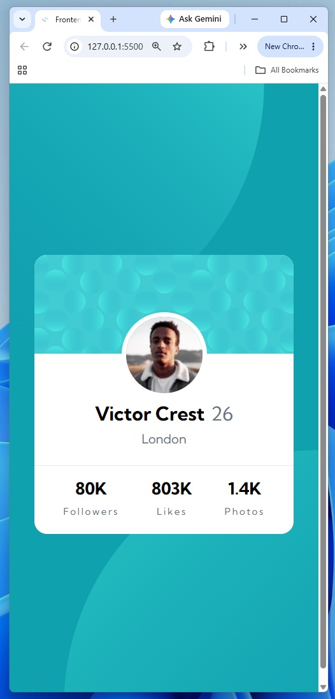

# Frontend Mentor - grid landing page solution

This is a solution to the [grid landing page challenge on Frontend Mentor](https://www.frontendmentor.io/challenges/grid landing page). Frontend Mentor challenges help you improve your coding skills by building realistic projects. 

## Table of contents

- [Overview](#overview)
  - [The challenge](#the-challenge)
  - [Screenshot](#screenshot)
  - [Links](#links)
- [My process](#my-process)
  - [Built with](#built-with)
  - [What I learned](#what-i-learned)
  - [AI Collaboration](#ai-collaboration)

## Overview

### The challenge

Users should be able to:

- View the optimal layout depending on their device's screen size

### Screenshot

### Links

- Solution URL: [https://github.com/Acemeistre/FEM_profile-card-component/]
- Live Site URL: [https://acemeistre.github.io/FEM_profile-card-component/]

## My process

### Built with

- Semantic HTML5 markup
- CSS custom properties
- Flexbox
- CSS Grid

### What I learned

#### Achievements 

- Setting up a linear gradient from the Figma design, despite its non-use in the project.
- Using `position: relative` combined with the property `top` helps control element positions.

#### Challenges

- Multiple backgrounds on one element.
- Overlapping the avatar across the banner and the info section.
- Placing the two background circles. I got them close to the design and moved on, as the time cost outweighed the benefit.

#### Continued development/help

- Practise `background-position` until placing background images feels natural.
- Practise linking background image URLs correctly, since the path is relative to the CSS file, not the HTML.

## AI Collaboration

- Tools used - Claude.
- Used for - debugging and brainstorming solutions.